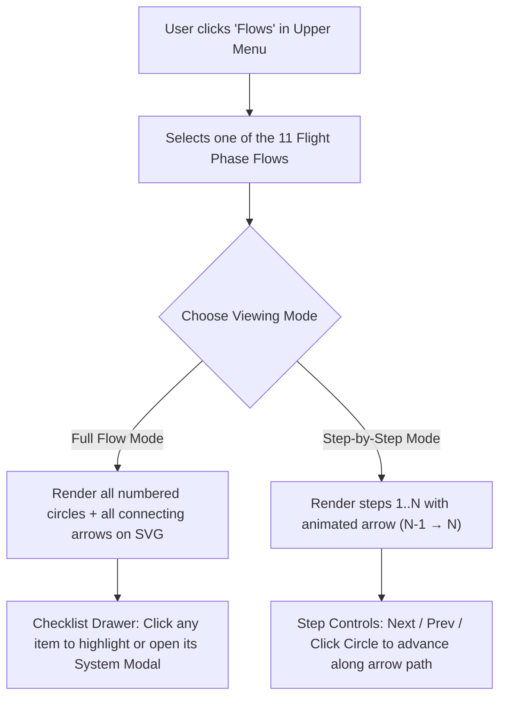

# Cockpit Flows Feature — Architecture & Implementation Plan

Based on the **Embraer E195-E2 Cockpit Flows** reference document (*Flows by Paulo Gonçalez*), this document outlines the design and technical implementation plan for adding interactive **Standard Operating Procedure (SOP) Cockpit Flows** to the Embraer E2 Cockpit Study App.

---

## 1. Feature Overview & User Experience

### 1.1 Upper Navigation Bar (`TopBar`)
A sleek, semi-transparent floating top bar (`position: fixed; top: 12px; left: 50%; transform: translateX(-50%); z-index: 900`) sits at the top of the viewport without blocking the cockpit canvas:

- **Flow Selector Button / Dropdown (`Flows ▾`)**:
  Clicking opens a menu of all **11 flight phase flows**:
  1. `INTERNAL SAFETY INSPECTION`
  2. `Power up`
  3. `Before Start (to the line)`
  4. `Before Start (Below the line)`
  5. `After Start`
  6. `Before Takeoff`
  7. `After Takeoff`
  8. `FL100 - Climb`
  9. `FL100 - Descent`
  10. `After Landing`
  11. `Shutdown`
- **Role Filter Toggle**:
  Matches the color-coding in the PDF:
  - **All Actions** (Default)
  - **LSP / PF Actions** — **Green (`#2ecc71`)**
  - **RSP / PM Actions** — **Yellow / Amber (`#f1c40f`)**
- **View Mode Toggle**:
  - **Full Flow Mode (`Show Entire Flow`)**: Renders all numbered badges (`①`, `②`, `③`...) and connecting directional arrows (`→`) for the selected flow simultaneously on the cockpit SVG, along with a collapsible checklist drawer showing all items.
  - **Step-by-Step Mode (`Step-by-Step`)**: Highlights one step at a time (`Prev` / `Next` buttons, keyboard `←` / `→` or `Space`, or clicking the numbered badge), draws an animated arrow from the previous control (`N-1`) to the current control (`N`), displays a compact floating step card (`Item — Action`, e.g., `BATT 1 Knob ... ON`), and optionally auto-pans/zooms to keep the active control in view.
- **Exit / Clear Flow Button (`×`)**: Returns the cockpit to normal free-exploration mode.

---

## 2. Visual Architecture: SVG Coordinate Overlay

### Why Render Arrows & Badges Inside the SVG Coordinate Space?
Because `painel_svg.svg` is zoomed and panned via `react-zoom-pan-pinch` (`viewBox="400 8700 20600 20100"`), rendering the flow paths and numbered badges as an **SVG overlay layer sharing the exact same `viewBox`** guarantees:
1. **Zero coordinate drift**: Arrows and numbered circles stay locked to the exact switches and knobs at any zoom level (`0.5x` to `12x`) and on any screen size.
2. **Automatic anchor coordinates**: Every clickable control in `painel_svg.svg` already has a `<rect class="hotspot-rect" x="..." y="..." width="..." height="..." />` (or `<path>`). We can compute each control's center point `(cx, cy)` automatically from its hotspot bounding box, or override with custom `(x, y)` coordinates for controls or areas that span multiple switches (e.g., `ELECTRIC Panel` or `EFB`).



---

## 3. Data Model (`src/data/flows.json`)

We will create `src/data/flows.json` containing the 11 flows. Each step references an existing `hotspotId` from `src/data/manual.json` (so clicking a step can also open or preview its manual description!) or a custom `(x, y)` coordinate if the item is outside existing hotspots:

```json
{
  "flows": [
    {
      "id": "internal-safety-inspection",
      "title": "INTERNAL SAFETY INSPECTION",
      "roles": ["LSP", "RSP"],
      "steps": [
        {
          "role": "LSP",
          "step": 1,
          "hotspotId": "mfd-left",
          "item": "Maintenance Status",
          "action": "CHECK"
        },
        {
          "role": "RSP",
          "step": 1,
          "hotspotId": "mfd-right",
          "item": "Maintenance Status",
          "action": "CHECK"
        },
        {
          "role": "RSP",
          "step": 3,
          "hotspotId": "elec-ac-bus-ties-knob",
          "item": "ELECTRIC Panel",
          "action": "SET"
        },
        {
          "role": "RSP",
          "step": 4,
          "hotspotId": "fuel-xfeed-knob",
          "item": "FUEL Panel",
          "action": "CHECK"
        },
        {
          "role": "RSP",
          "step": 5,
          "hotspotId": "pax-emer-lt-knob",
          "item": "PASSENGER SIGNS Panel",
          "action": "CHECK"
        },
        {
          "role": "RSP",
          "step": 6,
          "hotspotId": "wiper-left-knob",
          "item": "Windshield Wiper 1 and 2 Knobs",
          "action": "OFF"
        },
        {
          "role": "RSP",
          "step": 7,
          "hotspotId": "hyd-ptu-knob",
          "item": "HYDRAULIC Panel",
          "action": "CHECK"
        },
        {
          "role": "RSP",
          "step": 8,
          "hotspotId": "pneu-xbleed-btn",
          "item": "AIR COND/PNEUMATIC Panel",
          "action": "CHECK"
        },
        {
          "role": "RSP",
          "step": 9,
          "hotspotId": "oxy-mask-knob",
          "item": "PASSENGER OXYGEN Panel",
          "action": "CHECK"
        },
        {
          "role": "RSP",
          "step": 10,
          "hotspotId": "elt-switch",
          "item": "ELT Switch",
          "action": "ARM"
        },
        {
          "role": "RSP",
          "step": 11,
          "hotspotId": "ldg-gear-lever",
          "item": "LANDING GEAR Lever",
          "action": "DOWN"
        },
        {
          "role": "RSP",
          "step": 12,
          "hotspotId": "eng1-start-knob",
          "item": "Engine 1 and 2 START/STOP Selectors",
          "action": "STOP"
        },
        {
          "role": "RSP",
          "step": 13,
          "hotspotId": "speedbrake-lever",
          "item": "SPEEDBRAKE Lever",
          "action": "CLOSE"
        },
        {
          "role": "RSP",
          "step": 14,
          "hotspotId": "rat-manual-deploy-lever",
          "item": "RAT MANUAL DEPLOY Lever",
          "action": "STOW"
        },
        {
          "role": "RSP",
          "step": 15,
          "hotspotId": "flap-lever",
          "item": "SLAT/FLAP Lever",
          "action": "VERIFY POS"
        }
      ]
    }
  ]
}
```

### Special Cases Supported in `flows.json`:
- **Cold Airplane / First Flight of Day (`asterisk: true`)**: Steps marked with `*` in the `Power up` flow (e.g., `*6 FIRE EXTINGUISHER Panel`, `*8 DVDR CONTROL Panel`, `*9 ANNUNCIATORS TEST`, `*10/*11 EMER LT Selector`) display a `★` indicator badge.
- **Repeated Controls in the Same Flow**: When a control is visited twice in the same sequence (such as `EMER LT Selector` in `Power up` steps `*10 ON` and `*11 ARMED`), the badges automatically offset slightly (`dx: -160`, `dx: +160`) so both numbered circles (`10` and `11`) remain clearly readable side-by-side just like in the PDF.
- **Sub-sections (`section` property)**: Supports dividers like `AFTER PUSHBACK AND STARTUP CLEARANCE` in `Before Start (Below the line)`.
- **Callout Notes (`note` property)**: Supports crew notes like `After that, leave it on the synoptic flight controls` or `Monitor the flight controls check with LSP`.

---

## 4. How the Two Modes & Progressive Bottom List Work (UX Design)

### 4.1 Progressive Bottom Action List (`FlowBottomDock`)
Just like the dark legend box at the bottom of each page in the reference PDF, a docked **Bottom Action Panel** (`FlowBottomDock`) sits just above the footer:

```text
┌──────────────────────────────────────────────────────────────────────────────┐
│  Power up — RSP Actions (Step 3 of 17)     [◀ Prev] [Next ▶] [Show All] [▼] │
├──────────────────────────────────────────────────────────────────────────────┤
│  ① BATT 1 Knob ........................................................ ON  │
│  ② BATT 2 Knob ...................................................... AUTO  │
│ ▶③ Batteries Voltage ............................................... CHECK ℹ️│
└──────────────────────────────────────────────────────────────────────────────┘
```

- **Progressive Append in Step-by-Step Mode**:
  - Click 1 shows circle `①` on the panel and adds row `①` to the bottom list.
  - Click 2 draws the arrow `① → ②` on the panel and **appends row `②`** to the bottom list, highlighting row `②` as the active action and smoothly auto-scrolling the list to the newest item.
  - Each subsequent click advances the arrow (`② → ③`, `③ → ④`) and appends the next action item to the bottom list so the user always sees **both the current action and the history of steps completed so far**.
- **Full List in "Show Entire Flow" Mode**:
  - Displays all steps for the flow at once in a two-column layout (**Left column: Green `LSP / PF Actions`**, **Right column: Yellow `RSP / PM Actions`**), matching the exact layout of the PDF.
- **Smart Height & Collapsible Drawer (Protecting Screen Real Estate)**:
  - Because some flows (like `Before Start (to the line)`) have 31+ steps, an unconstrained list would cover the Control Pedestal.
  - By default, the bottom list has a compact height (`max-height: 22vh`, showing ~4–5 rows with smooth auto-scroll to the latest step) and a **`▲ Expand / ▼ Minimize`** toggle so the user can see the lower pedestal clearly or expand the full table anytime.
- **Two-Way Interaction & Manual Lookup**:
  - Each row in the bottom list has a leader-dot format (`Item .................... ACTION`) plus an **`ℹ️`** button that opens the existing `Modal.jsx` description from `src/data/manual.json` if the user wants to read how that switch/system works.
  - Clicking any previous row in the bottom list highlights that step's badge on the cockpit SVG.

---

## 5. Planned File Structure & Changes

| File | Purpose |
| :--- | :--- |
| `src/data/flows.json` | Complete dataset for all 11 Embraer E2 flows (LSP/PF & RSP/PM steps, actions, notes, and hotspot mappings). |
| `src/utils/hotspotCenters.js` | Parses `<g id="interactive-hotspots">` from `painel_svg.svg?raw` once at startup to build a lookup table `{ [hotspotId]: { x, y, width, height, cx, cy } }`. |
| `src/components/FlowTopBar.jsx` | Upper menu bar with the **Flows** selector dropdown (11 flows), **Role toggle** (`All` / `LSP-PF` / `RSP-PM`), and **Mode toggle** (`Full Flow` / `Step-by-Step`). |
| `src/components/FlowOverlaySvg.jsx` | Transparent `<svg viewBox="400 8700 20600 20100">` layered directly over `InlineCockpitSvg` inside `TransformComponent`, rendering `<defs>` arrowheads, connecting `<path>` arrows, and numbered `<g>` badges. |
| `src/components/FlowStepPanel.jsx` | Floating bottom/side HUD showing either the **Step-by-Step controller** (`Step X of Y`, `Item .... ACTION`, `Prev` / `Next` / `System Info`) or the **Full Flow checklist table**. |
| `src/App.jsx` & `src/App.css` | Integrates `activeFlowId`, `flowMode` (`'full'` \| `'step'`), `flowRole` (`'ALL'` \| `'LSP'` \| `'RSP'`), and `currentStepIndex` state, plus responsive styling for mobile and desktop. |
| `tests/flows.test.js` | Unit tests verifying all 11 flows exist, every referenced `hotspotId` exists in `painel_svg.svg` / `manual.json`, and every step has valid `role`, `step`, `item`, and `action` fields. |

---

## 6. Complete Mapping of the 11 Flows

1. **Internal Safety Inspection**: `LSP (1)` + `RSP (1–16)` — Overhead scan (Electric, Fuel, Pax Signs, Wipers, Hydraulic, Air Cond/Pneumatic, Oxygen, ELT) → Main Panel (Landing Gear) → Pedestal (Start/Stop, Speedbrake, RAT, Flaps, CBs).
2. **Power up**: `LSP (1–2)` + `RSP (1–17)` — BATT 1 ON → BATT 2 AUTO → Voltage/EICAS check → GPU/APU → Fire Test → DVDR Test → Annunciator Test → EMER LT ON then ARMED → NAV Light ON → Hyd/EFB/ECL/Cockpit Door/Strips.
3. **Before Start (to the line)**: `LSP (1–18)` (Left Glareshield, DCU 1, Reversionary, PFD 1, MFD 1, Autobrake RTO, Flight Control Mode, Ignition 1/2 Auto, EICAS Full, Speedbrake, Thrust Levers, ACP 1, Trim, MCDU 1) + `RSP (1–31)` (Full Overhead top-to-bottom scan column-by-column → Right Glareshield, DCU 2, Reversionary, PFD 2, MFD 2, ACP 2, Trim, Ground Prox, Disconnect Handles, MCDU 2).
4. **Before Start (Below the line)**: Pre-pushback (`LSP 1–5`, `RSP 1–4`: Fuel, Loadsheet, MCDU, Speed Knob, TO/GA, Trim) + After Pushback & Startup Clearance (`LSP 6–9`, `RSP 5–8`: Doors, Ground Equip, Parking Brake, Steering Disengage, Sterile Switch ON, Red Beacon ON, Hyd Sys 3 Elec Pump A ON).
5. **After Start**: `LSP (1–5)` (Ground Equip, EICAS, Steer Disengage, Flight Controls, Nosewheel Steering) + `RSP (1–5)` (Ground Equip, EICAS, Slat/Flap SET, Flight Controls, APU).
6. **Before Takeoff**: `LSP (1 + PF note)` (EICAS check) + `RSP (1–6)` (Cabin Crew Advise, External Lights ON, Brakes Temp, EICAS, Transponder TA/RA, T/O Config Button).
7. **After Takeoff**: `PM (1–2)` (Landing Gear UP → Slat/Flap 0).
8. **FL100 - Climb**: `PM (1–5)` (Sterile Switch OFF → Cabin Crew Advise → Fasten Belts → No Elec Devices → External Landing Lights OFF).
9. **FL100 - Descent**: `PF (1)` (Speed Knob) + `PM (1–6)` (Sterile Switch ON → Cabin Crew Advise → Fasten Belts → External Lights ON → Ice Speed Reset → Landing Speeds).
10. **After Landing**: `RSP (1–5)` (APU → External Lights → Transponder → Slat/Flap 0 → Pitch Trim 2.0).
11. **Shutdown**: `LSP (1–8)` (Thrust Levers IDLE → Parking Brake → Electric Panel GPU/APU → Start/Stop Selectors STOP → Hyd Sys 3 Pump 3A OFF → Red Beacon OFF → Sterile OFF → Fasten Belts OFF).

---

## 7. Step-by-Step Implementation & Git Commit Roadmap

To keep `main` (GitHub Pages production) untouched while developing, all work happens on branch **`feat/cockpit-flows`**. Any programmer or AI coding model can resume from the next unchecked step below.

### Branch Setup
- **Active Feature Branch**: `feat/cockpit-flows` (branched from `main`)
- **Production Branch**: `main` (deployed automatically by `.github/workflows/deploy.yml` only on pushes to `main`)

---

### [x] Step 1 — Flow Data Model, Hotspot Coordinate Extractor & Unit Tests (COMPLETED)
**Files Created**:
- `src/data/flows.json` — All 11 flight phase flows with `role` (`LSP`, `RSP`, `PF`, `PM`), `step`, `hotspotId`, `dx`/`dy` offsets, `asterisk`, `section`, `note`, `item`, and `action`.
- `src/utils/hotspotCenters.js` — `extractHotspotCenters(svgText)` and `resolveStepPoint(step, centersMap)` to compute SVG `(x, y)` coordinates in `viewBox="400 8700 20600 20100"`.
- `tests/flows.test.js` — Vitest suite verifying all 11 flows, `manual.json` `hotspotId` integrity, and SVG coordinate bounds.

**Commit Command**:
```bash
git add src/data/flows.json src/utils/hotspotCenters.js tests/flows.test.js FLOWS_FEATURE_PLAN.md
git commit -m "Feat(flows): Add 11 cockpit flows dataset, hotspot center extractor, and tests (Step 1/5)"
```

---

### [x] Step 2 — SVG Vector Arrow & Numbered Badge Overlay (`src/components/FlowOverlaySvg.jsx`) (COMPLETED)
**Goal**: Render the numbered circles (`①`, `②`, `③`...) and directional arrows (`→`) inside the cockpit `TransformComponent` using an inline `<svg viewBox="400 8700 20600 20100">`.

**Implementation Details for Next Agent/Developer**:
1. Create `src/components/FlowOverlaySvg.jsx`:
   - Props: `{ steps, visibleCount, activeStepIndex, onSelectStep, centersMap }`
   - Color palette:
     - `LSP` / `PF`: stroke & fill `#2ecc71` (Green), text `#0b1e13`
     - `RSP` / `PM`: stroke & fill `#f1c40f` (Yellow/Amber), text `#1a1405`
   - Define `<defs>` with `<marker id="flow-arrow-green" ...>` and `<marker id="flow-arrow-yellow" ...>` for arrowheads.
   - Group visible steps (`steps.slice(0, visibleCount)`) by `role` (`LSP`/`PF` vs. `RSP`/`PM`) so green arrows connect LSP steps (`1 → 2 → ...`) and yellow arrows connect RSP steps (`1 → 2 → ...`).
   - Shorten each line segment `[p1, p2]` by the badge radius (`R = 175` SVG units) at both ends so arrowheads land cleanly on the outer rim of the destination circle instead of underneath the number.
   - Render each step's circle (`r="175"`), step number `<text>` (`font-size="185"`), and optional `★` superscript if `step.asterisk === true`.
   - Highlight the active step (`index === activeStepIndex`) with an outer pulsing ring (`className="flow-badge-active"`).
2. Add unit test in `tests/flows.test.js` verifying helper geometry (line shortening / arrow path generation).

**Commit Command**:
```bash
git add src/components/FlowOverlaySvg.jsx tests/flows.test.js FLOWS_FEATURE_PLAN.md
git commit -m "Feat(flows): Add SVG arrow and numbered badge overlay component (Step 2/5)"
```

---

### [ ] Step 3 — Upper Flow Selector Menu (`src/components/FlowTopBar.jsx`)
**Goal**: Add the top floating navigation bar where the user chooses any of the 11 flows, filters by crew role, and toggles between **Step-by-Step** and **Full Flow** modes.

**Implementation Details for Next Agent/Developer**:
1. Create `src/components/FlowTopBar.jsx`:
   - Props:
     - `flows`: array of 11 flows from `src/data/flows.json`
     - `activeFlowId`: string or `null`
     - `onSelectFlow(flowId)`: selects a flow (or `null` to exit flow mode)
     - `flowRole`: `'ALL'` | `'LSP'` | `'RSP'` (automatically maps to `'PF'` / `'PM'` when the selected flow uses `PF`/`PM` roles)
     - `onChangeRole(role)`: updates role filter
     - `flowMode`: `'step'` | `'full'`
     - `onChangeMode(mode)`: switches between Step-by-Step (`'step'`) and Show Entire Flow (`'full'`)
   - UI Elements:
     - `<select>` or custom dropdown button showing `✈️ Cockpit Flows` (plus all 11 flow titles).
     - When `activeFlowId` is selected: show Role pills (`All`, green `LSP/PF`, yellow `RSP/PM`), Mode pills (`Step-by-Step`, `Full Flow`), and an `Exit Flow (×)` button.

**Commit Command**:
```bash
git add src/components/FlowTopBar.jsx FLOWS_FEATURE_PLAN.md
git commit -m "Feat(flows): Add upper FlowTopBar menu for selecting flows, roles, and modes (Step 3/5)"
```

---

### [ ] Step 4 — Progressive Bottom Action List (`src/components/FlowBottomDock.jsx`)
**Goal**: Display the docked bottom checklist panel that progressively appends each action row (`① Item .......... ACTION`) as each arrow appears in Step-by-Step mode, or shows all rows in Full Flow mode.

**Implementation Details for Next Agent/Developer**:
1. Create `src/components/FlowBottomDock.jsx`:
   - Props:
     - `flow`: current flow object
     - `visibleSteps`: array of steps currently revealed (`steps.slice(0, currentStepIndex + 1)` in `'step'` mode, or all filtered `steps` in `'full'` mode)
     - `totalSteps`: total steps in the filtered flow
     - `activeStepIndex`: current active step index
     - `flowMode`: `'step'` | `'full'`
     - `onPrev()`, `onNext()`, `onShowAll()`, `onResetStep()`
     - `onSelectStep(index)`: clicking a row highlights that step on the SVG
     - `onInspectHotspot(hotspotId)`: clicking the `ℹ️` button opens `Modal.jsx` with `manualData[hotspotId]`
   - Auto-scrolls the list container (`useRef` + `scrollIntoView({ behavior: 'smooth', block: 'nearest' })`) whenever `activeStepIndex` increases so the newly appended item is always in view.
   - Includes a collapse/expand button (`▲` / `▼`) so users on small screens can minimize the drawer at any time.

**Commit Command**:
```bash
git add src/components/FlowBottomDock.jsx FLOWS_FEATURE_PLAN.md
git commit -m "Feat(flows): Add progressive FlowBottomDock checklist component (Step 4/5)"
```

---

### [ ] Step 5 — Main App Integration, Keyboard Shortcuts, Responsive CSS & Final Tests
**Goal**: Wire `FlowTopBar`, `FlowOverlaySvg`, and `FlowBottomDock` into `src/App.jsx` and `src/App.css`, add keyboard navigation (`ArrowRight` / `Space` for next step, `ArrowLeft` for previous step), and update tests.

**Implementation Details for Next Agent/Developer**:
1. In `src/App.jsx`:
   - Compute `const hotspotCenters = useMemo(() => extractHotspotCenters(painelSvgRaw), []);`
   - Add state: `activeFlowId`, `flowRole` (`'ALL'`), `flowMode` (`'step'`), and `currentStepIndex` (`0`).
   - Place `<FlowOverlaySvg ... />` inside `<TransformComponent>` right after `<InlineCockpitSvg />` inside a shared positioning wrapper `<div className="cockpit-stage">`.
   - When a flow is active in `'step'` mode, clicking the SVG canvas (outside a specific hotspot or on the active badge) can optionally advance to the next step, while clicking any hotspot's `ℹ️` button (or clicking a hotspot directly) opens the system manual `Modal`.
2. In `src/App.css`:
   - Style `.cockpit-stage` (`position: relative`), `.flow-overlay-svg` (`position: absolute; inset: 0; pointer-events: none` with `pointer-events: auto` on `.flow-badge`), `.flow-top-bar`, and `.flow-bottom-dock` (with `@media` queries for mobile portrait/landscape).
3. Run `npm test` and `npm run build` to verify all tests and SVG security checks pass, then merge `feat/cockpit-flows` into `main` when ready for production.

**Commit Command**:
```bash
git add src/App.jsx src/App.css tests/app.test.js tests/flows.test.js FLOWS_FEATURE_PLAN.md
git commit -m "Feat(flows): Integrate Cockpit Flows UI, styles, keyboard navigation, and tests (Step 5/5)"
```


